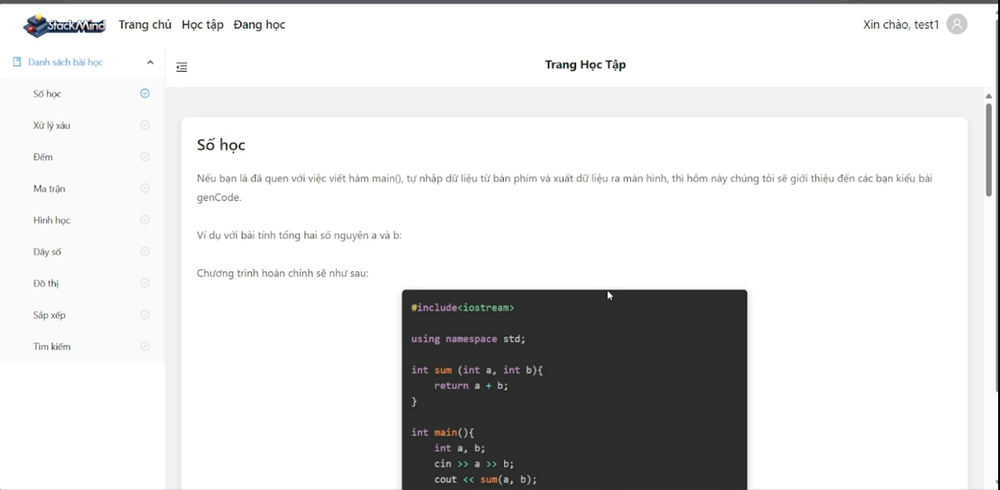
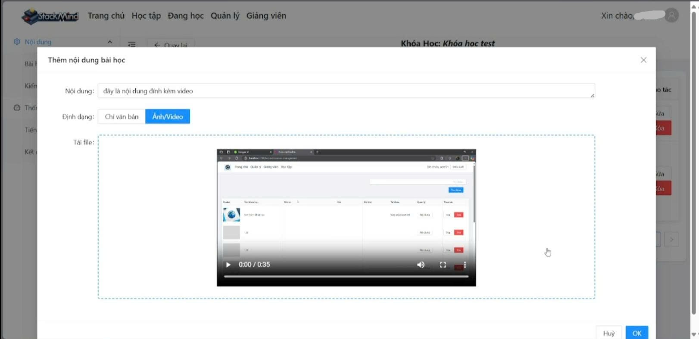
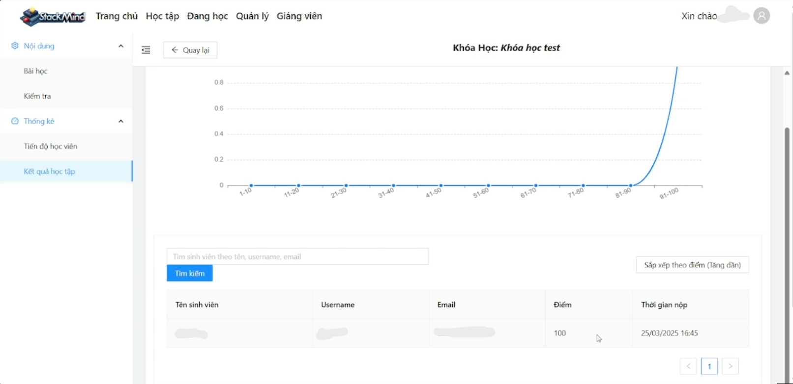

# StackMind — E-Learning Platform (Frontend)

Angular 19 web app for **StackMind**, an online learning platform with video lessons, exams and progress analytics.
Built as a team graduation project at UNETI (2025, graded 9.4/10). I was the team lead and main developer.

Backend (ASP.NET Core 8 API): [Be_QuanLyKhoaHoc](https://github.com/Strikerzzzz/Be_QuanLyKhoaHoc)


## Features by role

**Student**
- Browse and search the course catalog and study lesson by lesson.
- Watch HLS video lessons through a custom player built on hls.js.
- Take exams and assignments; track personal progress and statistics.

**Lecturer**
- Manage courses, lessons and lesson content (text, images, video upload).
- Follow student progress and results with charts (ECharts) and searchable, sortable result tables.

**Admin**
- Manage users: roles, lock/unlock accounts.
- View system statistics.

**Shared**
- Registration with email confirmation, JWT login with automatic token refresh (HTTP interceptor), role-based route guards.
- Botpress webchat widget.

## Tech stack

Angular 19 (standalone components) · TypeScript · ng-zorro-antd · hls.js · ngx-echarts · NSwag-generated API client

The API client is generated from the backend's Swagger definition with NSwag (`nswag/service.config.nswag`), so frontend models stay in sync with the API.

## Project structure

| Folder | Contents |
|---|---|
| `src/app/pages/home` | Landing page and course catalog |
| `src/app/pages/learning` | Course detail, study page, exams |
| `src/app/pages/my-learning` | Enrolled courses and personal statistics |
| `src/app/pages/lecturer` | Course management, content editor, student progress and results |
| `src/app/pages/admin` | User management and system statistics |
| `src/app/shared` | Generated API client (`api-client.ts`) and shared components, including the HLS video player |
| `src/app/guards` | Authentication and role guard |
| `src/app/services` | Auth service and JWT interceptor |

## Getting started

Requirements: Node.js 18.19+ (or 20/22) and the backend API running.

```bash
npm install
npm start          # http://localhost:4200
```

Set the API address in `src/environments/environment.ts` (`API_BASE_URL`).
To regenerate the API client after backend changes, run NSwag with `nswag/service.config.nswag`.

## Screenshots

| Learning page | Lesson content editor | Results analytics |
|---|---|---|
|  |  |  |

The UI is in Vietnamese. Personal data in the screenshots is blurred.
